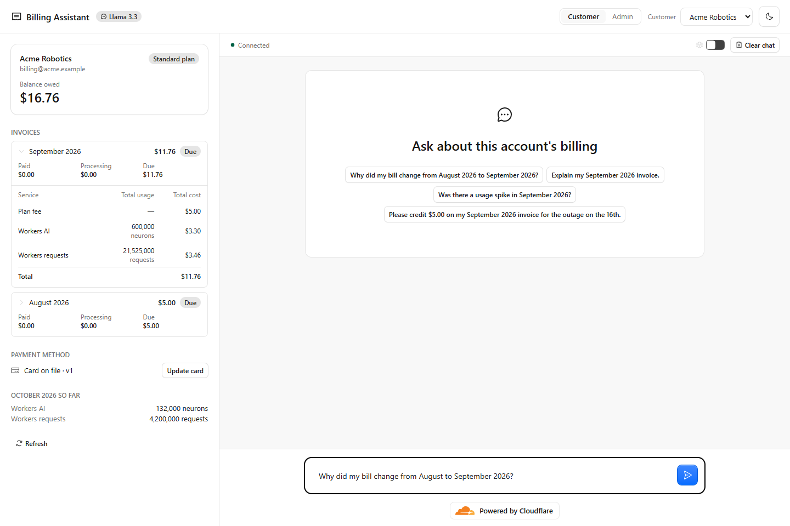
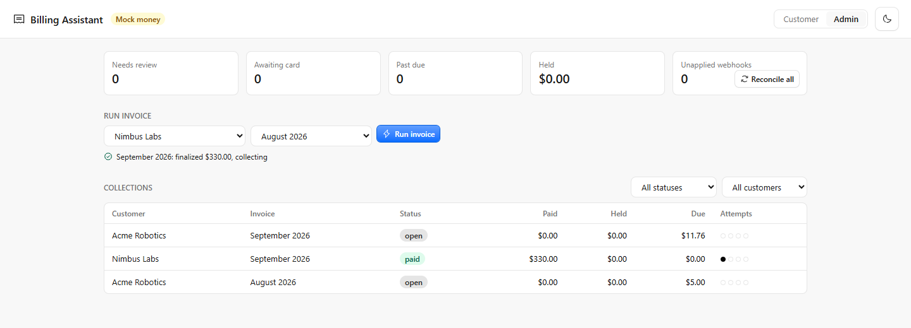
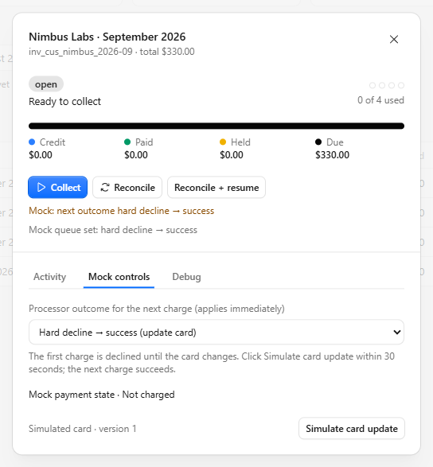
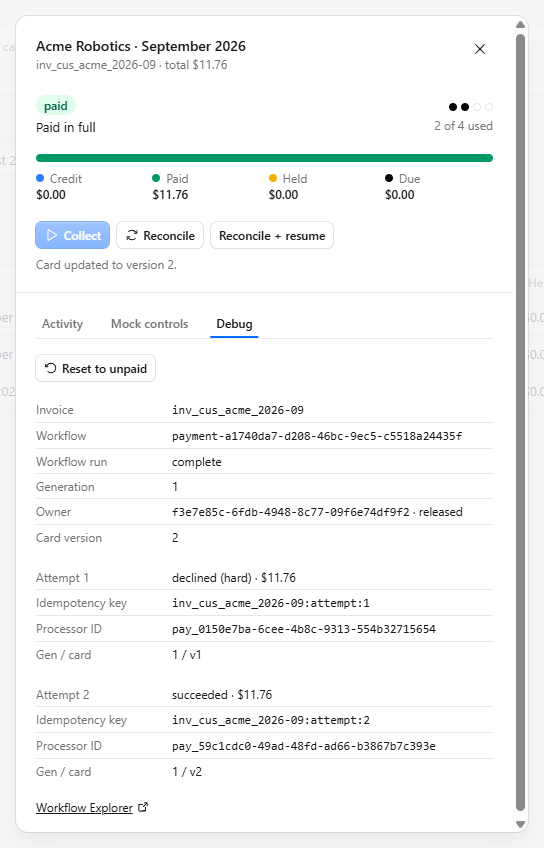

# Billing Assistant

An AI billing assistant for a usage-based cloud platform, built on Cloudflare
Workers AI, Agents, Workflows and D1. Explain invoices, investigate usage changes,
approve credits, and try payment-recovery scenarios. Billing math runs in code,
not the model.

**AI-assisted development:** [PROMPTS.md](PROMPTS.md) records the prompt history.

## How it meets the assignment

- **LLM:** Llama 3.3 on Workers AI explains bills using customer-scoped tools.
- **Workflow / coordination:** Cloudflare Workflows handle invoicing and payment
  retries, coordinating Workers and Durable Objects.
- **User input:** React chat streams messages over WebSockets through the Agents SDK.
- **Memory / state:** each customer's agent stores chat history in Durable Object
  SQLite; D1 persists billing, credits and payment records.

## Hosted demo

**Link:** _added after deployment_

The hosted demo needs no setup: open the link and sign in with your email
(Cloudflare Access sends a one-time code).

**The demo is shared.** Everyone who signs in sees and changes the same data.
It returns to the seed when someone new signs in after 15 minutes without
activity, so you normally start fresh; if someone else is using it, a banner
says so. **Reset demo** in the banner reseeds it at any time, for everyone.

To deploy your own copy, see [deploying the hosted demo](docs/deploy.md).

## Local setup

Requires **Node.js 24+** and a Cloudflare account for chat (Workers AI runs remotely).

```sh
npm install
npx wrangler login
npm run db:setup
npm run dev
```

Open <http://localhost:5173>. Vite starts both the app and mock payment processor.
`db:setup` applies migrations and seeds demo customers only when the database is
empty; it preserves existing data. Stop dev before running setup or direct-file
billing CLI commands, especially on Windows: the running dev server holds the
database files open.

To return everything to the seed (billing data, mock processor and chats),
click **Reset demo** in the banner, or run `npm run billing -- reset-demo`.
Both run inside the dev server, so it keeps running, and they leave the
database on the latest migrations.

**Local demo:** there is no authentication. Keep the app and local Explorer
private; without the hosted demo's Access settings, the API answers only on
`localhost`. Mutating APIs reject foreign browser origins; originless CLI requests
and HMAC-verified processor callbacks remain supported. This is not authentication.
Payment controls need no AI calls; see [offline, isolated setup](docs/local-testing.md#safe-setup-and-isolation)
if you want to run without remote bindings.

## Quick manual

### 1. Check a customer's bill and ask the assistant



- **Customer selector** switches the account and its separate chat history.
- **Invoice month** expands a Service / Total usage / Total cost table and approved
  credits. Usage tiers are combined per service; the plan fee stays separate. Paid, Processing
  and Due show where the balance stands; **Refresh** reloads billing data.
- **Chat** accepts a suggested question or your own message. Press **Enter** to
  send, **Shift+Enter** for a new line, or the stop button to stop generation.
- **Approve / Reject** appears when the assistant proposes a credit. Nothing is
  credited without approval; paid or reserved amounts cannot also be credited.
  Use an unpaid, uncollected invoice to try this.
- **Update card** simulates a new payment method—no card details are collected.
  The bug toggle shows chat debug data; **Clear chat** removes this account's
  conversation, not its billing records.

### 2. Run an invoice in Admin



Switch to **Admin** (or open `/admin`). Choose a customer and an ended month,
then click **Run invoice**. The Workflow finalizes the invoice but charges
nothing yet: its payment dialog opens so you can pick a mock outcome first, then
click **Collect**. With no outcome chosen, the charge succeeds.

Use **All statuses / Needs attention** and the customer filter to narrow the
collection table. Click an invoice row to open its payment controls.
**Reconcile all** checks collections and unapplied webhooks without requesting
new collection runs.

### 3. Try payment failures and recovery



1. Run an invoice (or open an uncollected one) and choose a scenario in **Mock
   controls**. It applies immediately to future attempts, not past ones.
2. Click **Collect**. For **Hard decline → success**, click **Simulate card
   update** while the Workflow waits for a newer card.
3. **Reconcile** checks original processor keys and unapplied webhooks.
   **Reconcile + resume** also permits a new collection run and may charge the
   remaining mock balance. Neither goes past the four automatic attempts.
4. After four declines the invoice is past due and **Collect** becomes **Retry
   payment**: each click is one manual attempt, charged at once. Pick the next
   outcome in Mock controls first. A hard decline needs **Simulate card update**
   before retrying.

**Mock controls** show the mock processor's own state beside the invoice's:
the queue of outcomes for its next charges, and each charge it holds with its
state and webhook deliveries. Each charge offers only the actions the
processor's [state model](processor/README.md#state-model) allows:

| Charge state | Actions                                            |
| ------------ | -------------------------------------------------- |
| Pending      | Succeeds, Soft decline, Hard decline, Send webhook |
| Declined     | Succeeds (a late success), Send webhook            |
| Succeeded    | Send webhook                                       |

Every state change sends a signed webhook, and **Send webhook** sends a new
event for the current state. A dropped (lost-webhook) or given-up delivery can
be delivered again. The processor never looks at billing data; the billing side
decides what each webhook means. A late success after four soft declines pays
the invoice without a new charge. If it is not safe, for example because a
newer attempt is already charging, the invoice shows a conflict instead.
**Held** means the processor result is unresolved, not failed. See the [payment walkthrough](docs/local-testing.md#payment-walkthrough) for
timing, retry limits and more scenarios.

### 4. Inspect what happened



**Activity** shows the durable event timeline. **Debug** shows Workflow status,
attempts, idempotency keys and processor IDs, with a link to **Workflow Explorer**.
Check the money totals—not just Workflow completion—to confirm payment.

**Reset to unpaid** is destructive demo tooling: after confirmation it clears
that invoice's payment history and reopens collection; credits stay. Use it only
when deliberately restarting a demo scenario.

## Checks

```sh
npm run check
npm test
npx vite build
```

## More documentation

- [Deploying the hosted demo](docs/deploy.md) — Cloudflare Access, shared-demo resets and deploy steps.
- [Architecture and billing design](docs/architecture.md) — components, AI guardrails, exact money and ledger invariants.
- [Local testing and CLI](docs/local-testing.md) — isolated demos, recovery scenarios and verification.
- [Payment Workflow](docs/payment-workflow.md) — payment design and implementation map.
- [Observability](docs/observability.md) — local Explorer, logs, traces and correlation queries.
- [Mock processor](processor/README.md) — processor protocol and standalone development.
- [Prompt history](docs/prompt-history.md) — how [PROMPTS.md](PROMPTS.md) is recorded.

Based on Cloudflare's [agents-starter](https://github.com/cloudflare/agents-starter)
([MIT license](LICENSE.agents-starter)).
