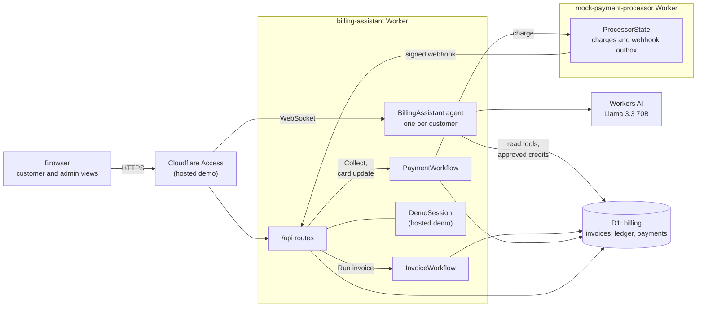
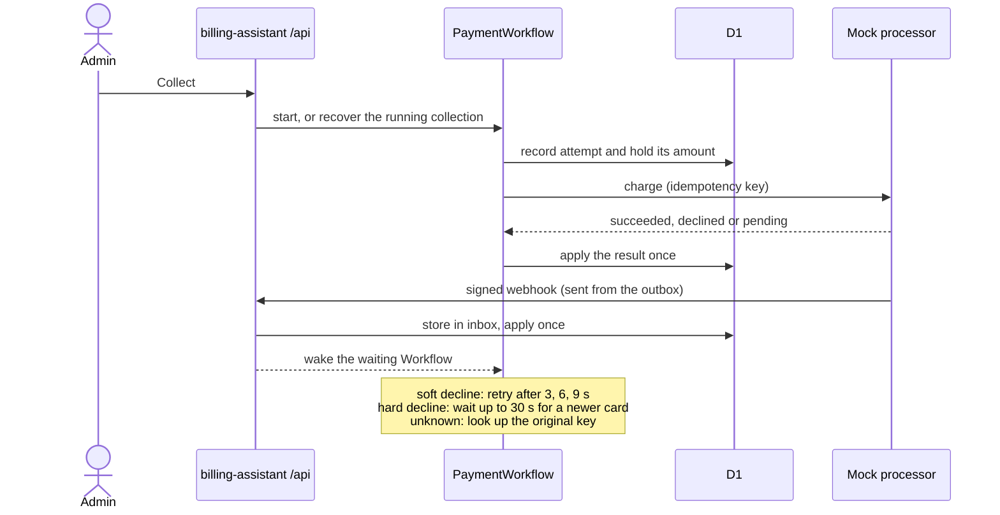

# Architecture and billing design

For setup and the illustrated guide, see the [README](../README.md).

The app is two Workers. **billing-assistant** serves the UI, the API, one chat
agent per customer and two Workflows, with all billing data in D1.
**mock-payment-processor** stands in for a card processor and is reachable only
through a service binding. The model explains bills; it never calculates or
moves money. Pricing, invoicing, payments and the ledger are ordinary tested
code in [`src/billing/`](../src/billing/) and [`src/payments/`](../src/payments/).

## Overview

| Component        | Implementation                                                                                        |
| ---------------- | ----------------------------------------------------------------------------------------------------- |
| UI               | React + Vite. Chat streams over a WebSocket through the Agents SDK.                                   |
| Chat agent       | `BillingAssistant` Durable Object, one per customer; its SQLite holds that customer's chat.           |
| LLM              | Llama 3.3 70B on Workers AI (`@cf/meta/llama-3.3-70b-instruct-fp8-fast`).                             |
| Billing data     | One D1 database, the source of truth for every customer's invoices, credits, payments and ledger.     |
| Workflows        | `InvoiceWorkflow` finalizes a month; `PaymentWorkflow` collects it.                                   |
| Mock processor   | Separate Worker. A SQLite Durable Object stores charges by idempotency key and an outbox of webhooks. |
| Service bindings | App → processor for charges; processor → app for HMAC-signed webhooks. Neither is public.             |
| Hosted demo gate | Cloudflare Access in front, its token verified in the Worker; `DemoSession` reseeds shared data.      |

## How the main actions flow

**Chat.** The browser opens a WebSocket to the customer's agent. The agent
calls Llama 3.3 with tools that read only that customer's billing data. A credit
is only a proposal until a person clicks **Approve**; then the tool writes it to
D1.

**Run invoice.** `POST /api/invoice-runs` starts `InvoiceWorkflow`, which opens
a draft (closing the month to new usage), finalizes it, and reconciles the
ledger. Each is a checkpointed step, and nothing is charged.

**Collect.** Payment is a separate Workflow so that an admin can choose a mock
outcome first:

The attempt and its held amount are written before the processor is called, so
an unknown result never loses track of money. The response, a status lookup and
the webhook can all report the same charge; D1 applies it once, whichever
arrives first, including after the Workflow has ended.

## AI guardrails

- **Customer-scoped tools** ([`assistant-tools.ts`](../src/assistant-tools.ts)).
  Each customer has their own agent, and its tools query only that customer's
  data: account overview, invoice details, monthly usage, month-over-month
  comparison, daily usage with spike detection, and payment state. Choosing a
  customer is scoping, not authentication.
- **No arithmetic by the model.** Comparisons, percentages, medians and
  per-meter charges are computed in [`reports.ts`](../src/billing/reports.ts)
  and returned already formatted.
- **Credits need human approval.** `issueCredit` has `needsApproval: true`, so
  the UI shows an Approve/Reject card. The tool call ID is the credit's
  idempotency key, so a replayed approval cannot credit twice. The database caps
  credits at the total minus credits, payments and held amounts. The assistant
  has no tool that charges or changes payments.
- **Fixed replies at the edges.** A rejected credit gets a fixed reply without
  calling the model. After a failed credit, the credit tool is withheld for that
  turn, so the model explains the error instead of retrying.

Workers AI streams Llama 3.3 output in two formats in each chunk, and
`workers-ai-provider` reads both. Left alone, text appears twice and tool-call
arguments interleave into invalid JSON, so
[`workers-ai.ts`](../src/workers-ai.ts) removes the duplicate first.

## Invoice Workflow

[`invoice-workflow.ts`](../src/invoice-workflow.ts) has three steps: open the
draft invoice, finalize it (price, lines and ledger in one atomic batch), and
reconcile the ledger. Bad input, such as an unknown customer or a month that has
not ended, fails at once instead of retrying. Every billing operation is
idempotent, so a repeated step is harmless. Billing starts with a customer's
first full month; there is no proration.

## Payment Workflow

[`payment-workflow.md`](payment-workflow.md) has the full design. In short:

- **Four automatic attempts** share one budget. After that, each **Retry
  payment** allows exactly one more attempt.
- **Retries of the same attempt reuse its key and amount**, so a timeout or
  outage cannot charge twice.
- **Unknown money stays held** after three recovery checks, even when the
  Workflow ends in review, until a result arrives or someone reconciles.
- **Reconcile** applies stored webhooks and looks up original keys. **Reconcile +
  resume** may also start a new run, still within the attempt budget.
- Notices such as "update your card" are records in the timeline, not emails.

## Billing data

Migrations:

- [Billing schema](../migrations/0001_billing_schema.sql)
- [Price catalog](../migrations/0002_price_catalog.sql)
- [Payments and cash ledger](../migrations/0003_payments.sql)
- [Demo payment reset](../migrations/0004_payment_debug_reset.sql)

| Table                                                             | Purpose                                                              |
| ----------------------------------------------------------------- | -------------------------------------------------------------------- |
| `plans`, `meters`                                                 | Price plans (monthly fee) and what is metered (requests, AI neurons) |
| `price_tiers`                                                     | Graduated prices per plan and meter, e.g. first 10M requests free    |
| `customers`                                                       | Customers and their plan                                             |
| `usage_events`                                                    | Raw usage, keyed by the producer's idempotency key                   |
| `invoices`, `invoice_lines`                                       | Monthly invoices and their line items                                |
| `credits`                                                         | Approved credits against finalized invoices                          |
| `ledger_entries`                                                  | Append-only double-entry ledger, including cash/payment postings     |
| `payment_collections`, `payment_attempts`, `payment_reservations` | Ownership, attempt budget and held (unresolved) money                |
| `payments`, `payment_webhook_inbox`, `payment_timeline`           | Posted payments, received webhooks and the Activity timeline         |

### Invariants

- **Exact money.** Amounts are integer cents. Unit prices are integer
  micro-dollars, so sub-cent rates like $0.011 per 1,000 neurons are exact.
  Each invoice line is rounded half-up once, so lines add up to the total.
- **Idempotent usage.** Resending a usage event is a no-op; reusing its ID
  with different data is rejected as a conflict.
- **Two-step invoicing.** Opening a draft closes the month to new usage.
  Finalizing prices the frozen usage and writes the lines, ledger entries and
  final status in one atomic `db.batch()`. Every write is guarded on the
  invoice still being a draft, so retries and concurrent runs finalize it
  exactly once.
- **Double-entry ledger.** Each invoice debits accounts receivable and credits
  revenue; each credit reverses part of that. Triggers make ledger entries
  immutable, and a unique (transaction, account) key prevents double posting.
  The demo-only **Reset to unpaid** is a deliberate exception; see
  [payment boundaries](payment-workflow.md#deliberate-boundaries).
- **Capped allocation.** SQL guards keep credits + payments + held amounts at
  or below the invoice total, even under concurrent writes.
- **Reconciliation.** `reconcile()` reports unbalanced ledger transactions,
  invoices whose lines or postings do not match their total, unposted credits,
  invalid payment or hold postings and over-allocation. Payment reconciliation
  also checks original processor keys.

### Why D1

D1 keeps the project entirely on Cloudflare with no external database to host.
It cannot hold a transaction open while code runs, so each write is one
statement or one atomic batch, with SQL guards and unique constraints instead of
locks. A production billing system at scale would more likely use Postgres,
which D1's single-threaded design and 10 GB limit do not replace.

## Hosted demo

The hosted demo is protected by Cloudflare Access, and the Worker verifies the
Access token on every API and chat request, so a misconfigured Access app fails
closed. All reviewers share one copy of the data. The `DemoSession` Durable
Object sees every request, reseeds when a new reviewer arrives after 15 idle
minutes, and runs **Reset demo**. [Deploying the hosted demo](deploy.md) has the
details and setup steps.

## Demo boundaries

Not implemented: real payment processing or refunds, proration for mid-month
plan changes, price changes over time, taxes, or currencies other than USD.

The API has no authentication of its own: the hosted demo relies on Access,
and local dev answers only on loopback. Choosing a customer is scoping, not
authorization. The processor's bearer token and HMAC secret are public demo
values, not secrets. There is no card data or email. Do not expose local dev or
the Explorer publicly.

Local state lives under `.wrangler/state/`; isolated demos use a separate
directory ([local testing](local-testing.md)). See
[observability](observability.md) for the Activity timeline, the Cloudflare
dashboard, logs and traces. Whether money moved is answered by D1, not by logs.
