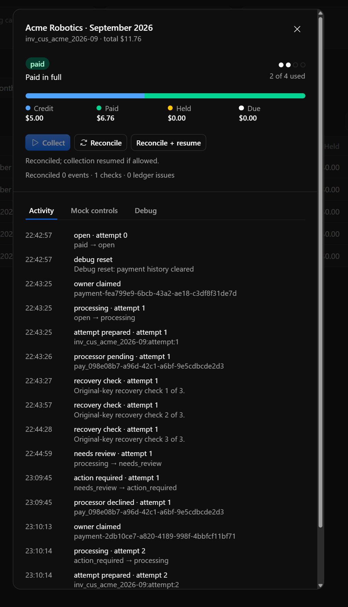
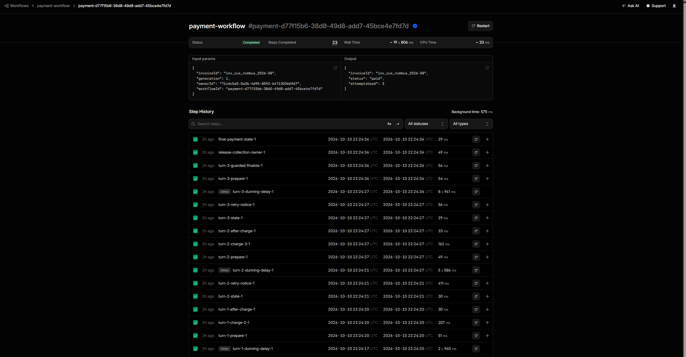
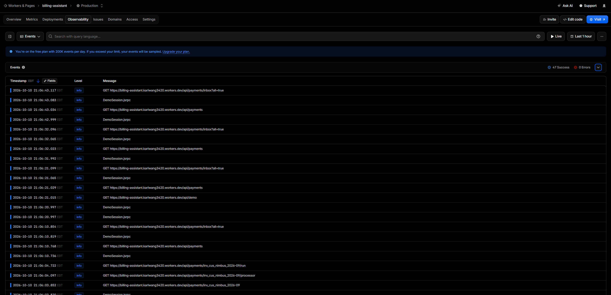

# Observability

There are four places to see what happened to a payment. Start with the first;
it works on both the hosted demo and local dev.

1. **Activity and Debug tabs** in the app: the durable record.
2. **Workflow instances** in the Cloudflare dashboard (hosted demo).
3. **Workers Logs** in the Cloudflare dashboard (hosted demo).
4. **Local Explorer** under `npm run dev`.

Whichever you use, money is answered by the invoice's amounts in D1, not by a
log line or a Workflow status. See [reading the results](#reading-the-results).

## Activity and Debug tabs



In **Admin**, click an invoice row. **Activity** is the invoice's timeline,
stored in D1 next to the money, so it is still there after a Workflow ends or
logs rotate. The example above is the **Unresolved pending → manual review**
scenario after **Reset to unpaid**: attempt 1 stays pending through three
recovery checks 30 seconds apart and goes to review. It is later declined from
**Mock controls**, needs a newer card, and attempt 2 pays the rest after a
$5.00 credit.

**Debug** lists each attempt with its idempotency key, processor payment ID
and card version, plus the Workflow instance ID used below. In local dev it
also links to the Explorer.

## Workflow instances (hosted)



In the dashboard, open **Workers & Pages → Workflows → payment-workflow** (or
`invoice-workflow`) and pick an instance. The instance ID is the **Workflow**
value in the Debug tab.

- **Input** names the invoice and collection generation. **Output** is the
  payment state when the run ended, here `"status": "paid"` after 3 attempts.
- **Step History** reads bottom to top. Steps are grouped in turns
  (`turn-1-…`, `turn-2-…`): `turn-N-charge-A` charges attempt A, the `sleep`
  steps are the dunning waits (3, 6 and 9 seconds in the demo), and
  `release-collection-owner` and `final-payment-state` close the run. A hard
  decline adds a `card-event` wait; an unknown result adds `recovery` checks.

**Completed** means the run ended, not that the invoice is paid: a run can
complete with the invoice past due or in review. Read the Output, or the
invoice itself.

## Workers Logs (hosted)



Open **Workers & Pages → billing-assistant → Observability**. Each request is an
event, and the UI polls, so `GET /api/payments…` and `DemoSession` calls fill
the list while a page is open.

To follow one invoice, type its ID, for example `inv_cus_nimbus_2026-09`, in
the search box. Search is a plain text filter. The payment code logs one JSON
line per event (`processor_charge`, `payment_collection_started`,
`payment_collection_finished`, `payment_reconciled`, …) with `invoiceId`,
`workflowInstanceId`, `attemptId` and `processorPaymentId`. Each line is logged
as a string, so search its text rather than filtering on those fields. Search
for an attempt or processor payment ID the same way.
Credentials, signatures and raw webhook bodies are never logged.

The free plan keeps 200,000 events a day and samples beyond that. Only
`billing-assistant` has Workers Logs enabled; the mock processor's logs are not
stored, so watch them live instead.

### Live logs

```sh
npx wrangler tail billing-assistant --format pretty
npx wrangler tail mock-payment-processor --format pretty
```

These stream new events only, while the command runs.

## Local Explorer

Open <http://localhost:5173/cdn-cgi/local/explorer> while `npm run dev` is
running (`/cdn-cgi/explorer` also works). It shows `payment-workflow` and
`invoice-workflow` instances with their checkpoints, D1, the processor's
Durable Objects, and **Observability** with logs and traces from both Workers.
Logs also print as JSON in the Vite terminal.

Local logs and traces can be queried with read-only SQL:

```sh
curl http://localhost:5173/cdn-cgi/local/explorer/api/local/observability/query \
  -H 'content-type: application/json' \
  -d '{"sql":"SELECT ts_ms, level, message, trace_id FROM logs WHERE message LIKE ? ORDER BY ts_ms DESC LIMIT 30","params":["%inv_cus_acme_2026-09%"]}'
```

The response is `{ success, errors, messages, result: { columns, rows } }`.
`logs.message` is a JSON array of the console arguments; use its `trace_id` to
query `spans`, and `json(attributes)` to read span attributes. The endpoint
accepts a single `SELECT`/`WITH` and returns at most 10,000 rows.

Other Explorer endpoints **can change data**, so keep dev on loopback. Its D1
"batch" runs statements one by one; it is not a substitute for the app's atomic
`db.batch()`.

Verified with Node 24.18.0, Vite 8.1.5, `@cloudflare/vite-plugin` 1.50.0,
Wrangler 4.118.0 and workerd 1.20260730.1; other versions may differ. The
integration test checks the Explorer page and queries local logs and spans from
both Workers.

## Reading the results

- A completed Workflow can mean past due or in review, not paid.
- A pending result that was applied correctly still shows as an **unresolved**
  processor check in **Reconcile**, even with no ledger issues.
- An applied check can be a confirmed **decline**. Read the invoice's status
  and attempts, not just the check result.
- A late signed success can move an invoice from review to paid after its
  Workflow ended; the Workflow's Output keeps saying review.
- To recover unresolved money, use **Reconcile** or
  `npm run billing -- reconcile-payments`, not raw SQL or a new key.

**Needs attention** in Admin counts unresolved holds, invoices waiting for a
card, past-due or conflicting invoices, and unapplied webhooks.

Logs and traces are diagnostics, not an audit export or a retention guarantee.
