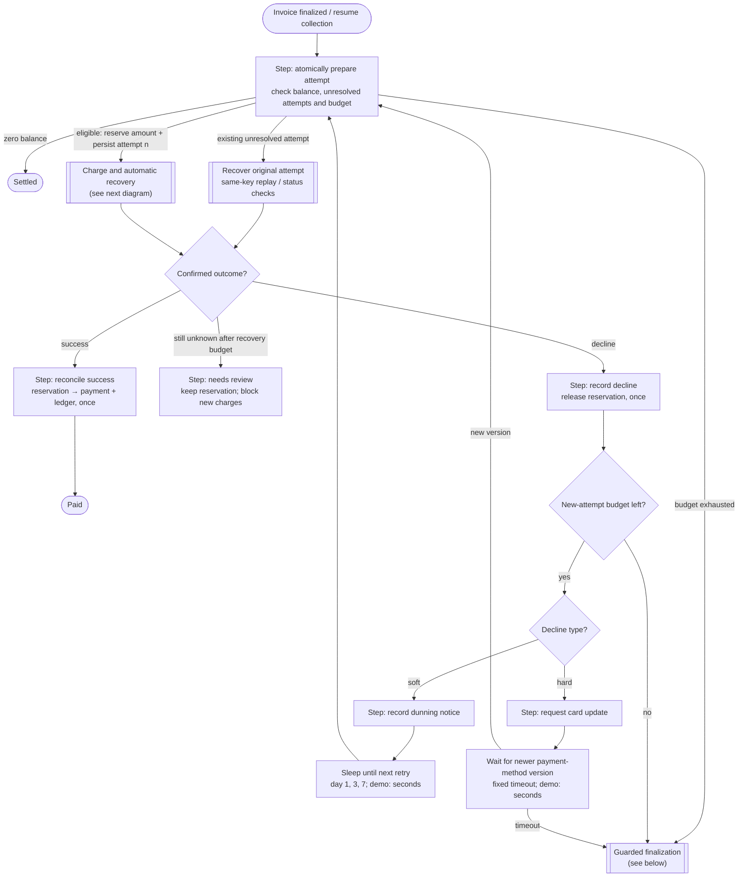
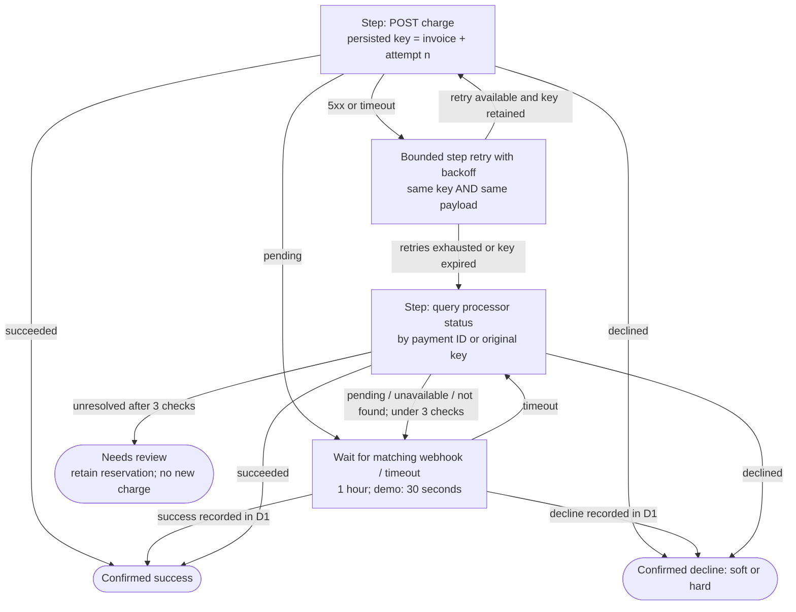
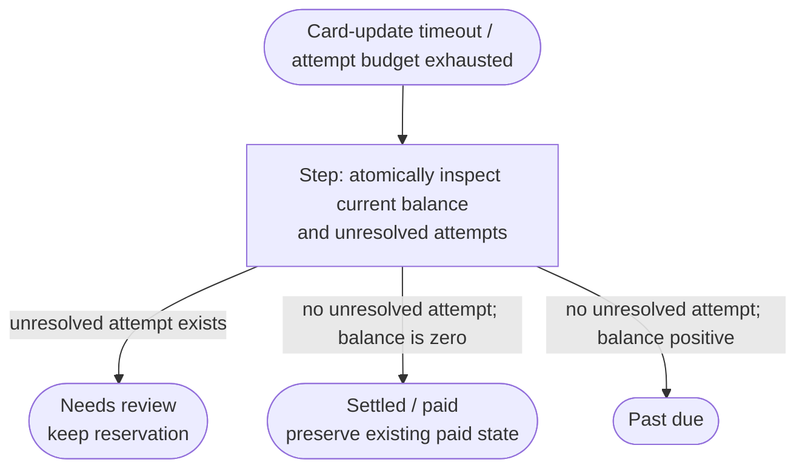
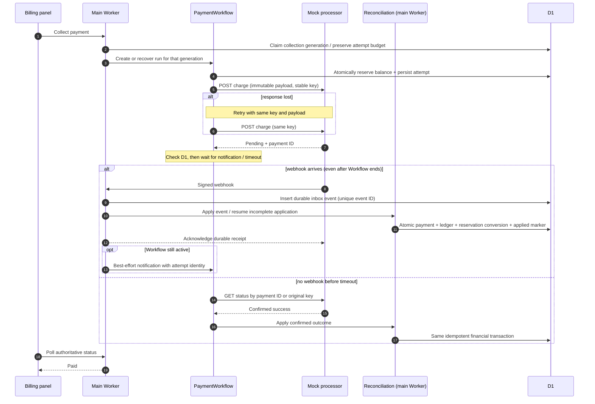
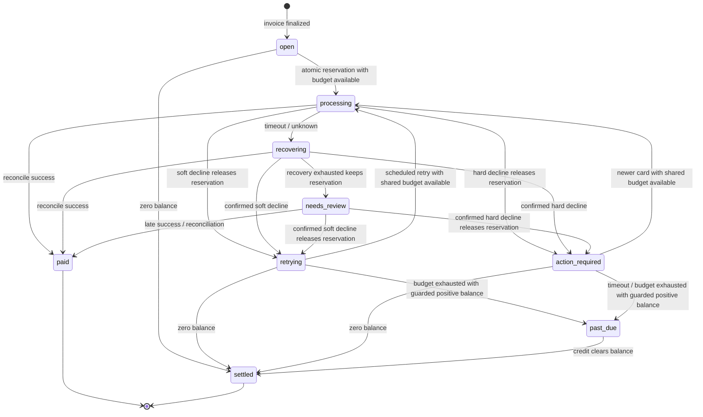

# Payment collection workflow (design)

> **Status:** implemented as a local, mock-money demonstration. Merchant D1,
> processor Worker, PaymentWorkflow, API/UI/CLI recovery and isolated integration
> tests are present. The diagrams below remain the approved contract; see the
> implementation/validation map at the end for limits and explicit test fixtures.

After an invoice is finalized, `PaymentWorkflow` collects payment from a mock
processor Worker. It handles outages, declines, pending charges and late or
duplicate webhooks. D1 is the global source of truth for attempts, reservations,
payments, webhook events and ledger entries. No real money or email is involved.

## Collection and dunning loop

Boxes labeled **Step** use checkpointed `step.do`. Successful results are saved;
failed executions may repeat, so external side effects must also be idempotent.
Each attempt and recovery check uses a distinct checkpoint name. Sleeps and
event waits are separate Workflow primitives, not nested inside `step.do`.

**Shared budget:** at most **four new charge attempts** per invoice collection
campaign (initial attempt plus three retries), including attempts after card
updates. The persisted attempt number never resets on Workflow restart,
manual recovery or card update. Same-key HTTP retries do not consume a new
attempt. Hard declines require a payment-method version newer than the one
used for that attempt; duplicate notifications do not authorize another charge
or extend the wait deadline. Soft-decline retries use the next unused day-1/3/7
slot after the initial attempt; elapsed slots do not cause a burst of retries.

**Atomic preparation:** permit only one active collection owner per invoice.
In one guarded D1 transaction/batch, check the remaining balance and shared
budget, reject a new attempt if any unresolved attempt exists, and persist the
next attempt with a reservation for the amount due. Persist the amount, currency,
payment-method version and idempotency key **before** calling the processor.
Retries reuse this immutable payload. Resuming an existing attempt does not
allocate another reservation or increment its number.

**Credit policy:** reject/defer a credit exceeding
`invoice total − credits − posted payments − unresolved reservations`.
Credit issuance and attempt preparation must enforce this invariant atomically,
not just read it before writing. An unknown outcome retains its reservation,
even in `needs_review`. Success converts the reservation to a payment;
only a definitive decline releases it without payment. A credit issued between
attempts reduces the next reserved amount or settles the invoice.

## Charge attempt and automatic recovery

A timeout is **temporarily unknown**, not immediately `needs_review`.
The recovery box above and the following diagram describe the same recovery
path, not two successive recovery loops.

Before waiting and after waking, check the durable attempt state in D1: an event
notification is a hint, not the financial source of truth. Unrelated or stale
events do not reset the deadline or recovery-check budget. The processor's
terminal outcomes are immutable; stale pending observations cannot regress a
resolved attempt. Contradictory terminal results block new charges and require
reconciliation rather than blindly releasing a reservation.

**Example:** the processor charges $20 but the response is lost. Same-key replay
returns the original charge, or status lookup confirms it, and reconciliation
records one payment. Manual review is only the fallback when recovery cannot
establish a definitive outcome.

Replay depends on the processor retaining the key and rejecting different
payloads under it. After key retention expires, use status reconciliation, not
blind charge replay. An unavailable lookup or `not found` alone is not proof that
a timed-out charge failed.

## Guarded finalization

Neither a card-update timeout nor an exhausted retry budget directly marks an
invoice past due. The terminal decision is an atomic guarded D1 operation.

A full credit during a card-update wait therefore settles the invoice rather
than flagging it past due. Credit/payment application also updates collection
status when the balance reaches zero; a later credit can settle a past-due
invoice. Any account-level delinquency flag is derived from the customer's
remaining past-due balances, not set unconditionally by one Workflow.

## Messages between services

The main Worker owns a **shared reconciliation function**, called both by
Workflow steps and webhook processing. It can apply financial outcomes even
when the original Workflow has ended.

This sequence shows success; a confirmed decline instead records the decline
and releases the reservation atomically. Payment application is deduplicated by
processor payment ID, not merely by webhook event ID. Different event IDs for
the same payment still produce one posting. Validate signature, invoice,
attempt, amount and currency before application.

**Recovery owner:** webhook handling invokes reconciliation immediately. A
local **Reconcile payments** action/command drains unapplied inbox events and
queries unresolved attempts by their original key. It is the explicit retry
owner for crashes after inbox insertion, failed processing, missing webhooks,
and ended Workflows; this demo does not assume a background queue exists.
Persist application state separately from notification delivery. A duplicate
event resumes incomplete application; an already-applied event is a no-op.
Failed Workflow notification never rolls back or prevents a payment posting.

**Manual-review exit:** late confirmed success applies through the same function
and moves `needs_review → paid` without needing the old Workflow. A confirmed
decline releases the reservation and records its type. The local recovery
action can start a new Workflow generation under the single-owner guard, using
the existing attempt number and remaining budget. Soft declines resume bounded
dunning; hard declines still require a newer payment method. If the balance is
zero or the budget is exhausted, guarded finalization applies instead.
Unknown outcomes remain reserved and blocked; an operator cannot force a fresh
charge merely by clicking retry. Claim/create recovery uses a stable Workflow
ID per generation so a lost create response does not create duplicate runs.

## Invoice payment status

Collection status is separate from the existing `draft` / `finalized` invoice
status. `needs_review` is recoverable financial state, even if the Workflow that
entered it has finished.

Entering `retrying` or `action_required` never grants a new-attempt budget.
If no attempts remain, immediately use guarded finalization rather than waiting
or charging again.

## Invariants and implementation checks

- **No double charge:** new keys only after a definitive decline; unknown
  outcomes receive bounded same-key replay/status checks, then manual review.
- **No overcollection:** credits + posted payments + unresolved reservations
  never exceed the invoice total; all competing mutations enforce this in D1.
- **No double posting:** apply each processor payment once, atomically with
  reservation conversion, ledger entries and financial state.
- **Balanced ledger:** payment debits cash and credits accounts receivable.
  Reconciliation compares internal payments with processor records.
- **Bounded collection:** four new attempts across soft declines, hard declines,
  restarts and manual recovery. Duplicate events never reset budgets/deadlines.
- **Late results remain actionable:** financial application is independent of
  Workflow lifetime; durable unapplied events have an explicit local retry owner.

Runtime validation must verify Cloudflare `waitForEvent` / `sendEvent` signatures,
timeout handling, early-event buffering/retention and local behavior. Ensure
exhausted charge-step retries reach recovery rather than just failing the run.
Correctness must not depend on event buffering: D1 and processor lookup remain
the recovery sources. Add the `cash` ledger account through a new migration,
update credit guards, and extend reconciliation to cover payments/reservations.
Keep these records in global D1, not chat Durable Objects.

## Demo controls and validation

Processor scenarios: success, soft decline, hard decline, outage, **success
with lost response**, pending, lost webhook and duplicate webhook. Shorten
dunning/wait delays to seconds; notices are local timeline/outbox entries.
Expose a simulated card update and **Reconcile payments** action for recovery.

Validate:

1. Lost response yields one processor charge and one balanced posting.
2. Unknown / unavailable / `not found` retains the reservation and never gets a
   fresh key; expired key retention never causes blind replay.
3. Parallel collection and credits before, during and after a charge cannot
   overcollect or double-reserve.
4. Crashes after reservation, processor success, inbox insertion, payment commit
   and notification recover without losing or duplicating financial effects.
5. Duplicate, stale, out-of-order and late events cannot regress financial state;
   late success after `needs_review` is applied independently of the old run.
6. A full credit during a card-update wait settles the invoice, not past due.
7. Repeated hard declines/card updates stop at the shared limit; manual recovery
   preserves attempt numbering and cannot bypass unresolved-charge blocking.
8. Run a local two-Worker integration test for real Workflow event behavior in
   addition to store/unit tests.

## Implementation and validation map

- **Global financial authority:** `migrations/0003_payments.sql` and
  `src/billing/payments.ts` implement guarded ownership/preparation, immutable
  attempts, reservations, paid/reserved-aware credit caps, shared reconciliation,
  cash ledger postings and durable inbox/timeline. Migration preserves existing
  invoices/ledger and backfills finalized collections. `billing setup` applies
  upgrades without reseeding existing customers/data.
- **Processor:** `processor/` owns separate SQLite idempotency/outbox state,
  nine scenario controls, indefinite key retention, durable alarms and signed
  callback delivery. Terminal outcomes cannot be force-edited. The lost-response
  scenario returns a deterministic 504 after committing success; it is not a
  physical socket-disconnect test. Unresolved pending stays pending until the
  mock processor is told to decide it (**Mock controls → Settle pending
  charge**, `POST /demo/settle`). That changes only processor state: the
  merchant learns the outcome through the normal signed webhook or an
  original-key lookup, and terminal outcomes still cannot be changed. No real money, email or card information exists.
- **Runtime:** `src/payment-workflow.ts`, `src/payments/collection.ts` and
  `service.ts` run actual Workflow checkpoints, sleeps and events. Charge retries
  use two retries after the first call; original-key automatic recovery has
  three checks. Demo waits are 30 seconds, dunning 3/6/9 seconds;
  the isolated `payment-test` Vite mode scales them by `PAYMENT_TIME_SCALE`
  (default 0.2) so integration tests finish faster. Elapsed durable
  deadlines skip sleeping, not the D1 re-read or status lookup; they never extend
  a deadline. A real local timeout regression caught and fixed the emulator's
  rejection of `sleepUntil` in the past.
- **Runtime signatures actually exercised:** `step.waitForEvent(name,
{ type, timeout })` and `instance.sendEvent({ type, payload })`. An isolated
  probe observes early buffering after creation, event-type matching and caught
  timeout. Financial correctness still does not assume indefinite event
  retention. Pending signed callbacks exercise the reverse service binding;
  missing callbacks fall back to original-key reconciliation.
- **Recovery surface:** `src/payments/api.ts`, billing-panel payment controls
  and `scripts/billing.mjs` expose read state/timeline, collect, processor
  inspection and explicit reconciliation. Resume is opt-in; no background queue
  is assumed. A pending observation can apply successfully but its reconciliation
  **check remains unresolved**, not a successful payment. Confirmed decline also
  does not mean paid. The assistant only reads payment state; existing credits
  still require approval and all arithmetic remains deterministic code.
- **Real two-Worker integration:** `tests/payment-integration.test.mjs` uses the
  actual Vite config with remote bindings disabled and fresh OS-temp persistence.
  It exercises success, soft/hard decline recovery, four-attempt exhaustion and
  resume, lost response, missing/duplicate webhook, pending, needs-review/late
  signed success and full-credit card timeout. It asserts unique payments,
  balanced ledger, retained unknown reservation and unchanged attempt budget.
  The runtime companion test covers actual outage backoff and automatic
  InvoiceWorkflow collection. Tests never reset user `.wrangler` state.
- **Explicit integration fixtures:** the late case delays only a real pending
  processor record's resolution timestamp in a stopped fresh test store; normal
  alarm/status/signing/delivery then resolve it. The test observes needs-review
  and the ended original run before late success. Full-credit testing uses a
  harness-only Vite transform to call unchanged `issueCredit` on the live bound
  D1, preserving atomic batch semantics without a production mutation endpoint
  or AI call. See [local testing](local-testing.md) for exact isolation details.
- **Layered invariant/crash evidence:** store/API tests inject rollback,
  inbox-application/notification failure, duplicates, stale/late outcomes and
  credit/reservation races. Fake-step tests cover unavailable/not-found/expired
  retention and repeated hard-decline budgets. These are not claims that every
  physical crash boundary or every hostile event ordering was injected through
  a real browser and both running Workers.
- **Observability actually probed:** pinned plugin 1.50.0 / Wrangler 4.118.0
  serve `/cdn-cgi/local/explorer`, structured correlation logs and local spans
  for both Workers. [Observability](observability.md) documents the verified
  read-only query route and limitations. Financial timeline remains D1 truth.

### Deliberate boundaries

This is an unauthenticated demo, not production payment infrastructure. Processor
bearer/HMAC credentials are public fixtures. No deployment, real processor,
refunds, production mail delivery, background reconciliation scheduler or
production observability retention was added. Local method updates are simulated
customer-level versions, not card-token storage. Keys/events are retained
indefinitely; there is no force-release or force-success control. The one
exception is the admin dialog's local **Debug → Reset to unpaid**
(`POST /api/payments/:invoiceId/debug-reset`, migration `0004`). It stops the
old run, clears that invoice's processor keys/outbox/queue first, then in one D1
batch deletes its payments, cash/receivable postings, reservations, attempts,
webhooks and timeline. The invoice reopens with four attempts and a new
generation; credits remain. No-delete triggers allow this only while that
invoice is unlocked inside the batch. A webhook already in flight at the reset
moment is not fenced; wait for active runs to settle before resetting.

UI invoice runs start collection automatically; direct-D1 CLI invoice
finalization leaves collection to the explicit local API command/control so a
scenario can be chosen first. Stop dev for migrations/legacy direct-file CLI
writes on Windows; new payment CLI commands use the running API. Existing demo
state was not migrated or reset during implementation. Independent review and
production/security hardening remain separate gates.
